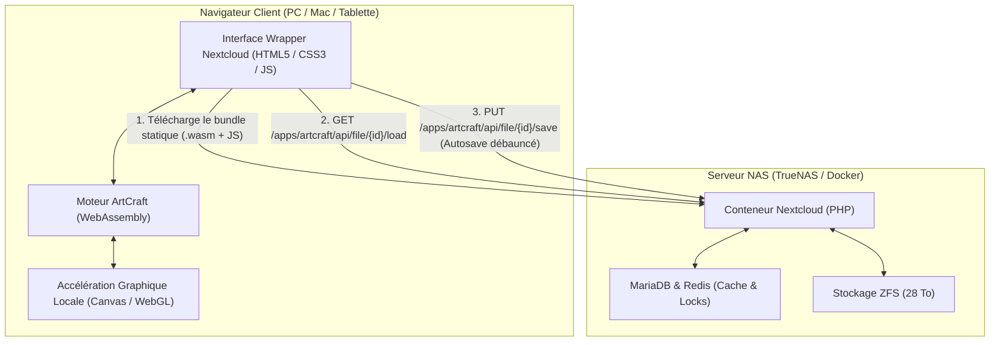

# NextCraft : Intégration d'ArtCraft dans Nextcloud

**NextCraft** est l'extension Nextcloud permettant d'intégrer les outils créatifs **ArtCraft** (Rust / WebAssembly) dans votre environnement Nextcloud avec une ergonomie et un flux de travail équivalents à **OnlyOffice**.

---

## 🏛️ Architecture



- **Calculs 100 % côté client** : Le moteur graphique s'exécute dans le WebAssembly du navigateur avec accélération GPU locale.
- **Empreinte serveur dérisoire** : L'utilisation CPU du NAS reste inférieure à 1 % (le NAS ne fait que servir les fichiers statiques et persister les projets).

---

## 📦 Structure du Projet

```text
nextcraft/
├── engine/                       # Moteur créatif vectoriel en Rust (Wasm)
│   ├── Cargo.toml                # Dépendances wasm-bindgen, web-sys, serde
│   ├── src/
│   │   ├── lib.rs                # Pont Wasm (API Bridge JS <-> Rust)
│   │   ├── model.rs              # Modèle de données & format binaire .craft
│   │   ├── renderer.rs           # Moteur de rendu Canvas 2D
│   │   └── export.rs             # Exportateurs SVG, PNG et données
│   └── build.sh                  # Script de compilation wasm-pack
├── artcraft/                     # Application Nextcloud (custom_apps/artcraft)
│   ├── appinfo/
│   │   ├── info.xml              # Métadonnées, dépendances, types MIME
│   │   └── routes.php            # Définition des routes HTTP Nextcloud
│   ├── lib/
│   │   ├── AppInfo/
│   │   │   └── Application.php   # Bootstrap & hooks du framework Nextcloud
│   │   ├── Controller/
│   │   │   ├── EditorController.php     # Vue plein écran studio & CSP
│   │   │   ├── ApiController.php        # API HTTP REST (délégation aux services)
│   │   │   └── PublicPageController.php # Partages par liens publics
│   │   ├── Service/
│   │   │   ├── DocumentService.php      # Gestion CRUD, validation & format .craft
│   │   │   ├── ExportService.php        # Exportation directe PNG, JPG, SVG
│   │   │   ├── LockService.php          # Verrouillage collaboratif exclusif & Heartbeat
│   │   │   └── DirectEditor.php         # Intégration Direct Editing Nextcloud
│   │   └── Listeners/
│   │       ├── RegisterTemplateFileCreatorListener.php # Option "+ Nouveau" (.craft)
│   │       ├── CreateFromTemplateListener.php          # Initialisation des projets
│   │       └── DirectEditorListener.php                # Association mimetypes
│   ├── templates/
│   │   ├── editor.php            # Workspace principal & Splash Screen GPU
│   │   ├── public.php            # Vue publique pour les liens de partage
│   │   └── error.php             # Page d'erreur conviviale
│   ├── css/
│   │   └── editor.css            # Styles plein écran, dark mode et studio
│   ├── js/
│   │   ├── main.js               # Intégration Files (+, clic direct, menu contextuel)
│   │   ├── editor.js             # Orchestrateur client principal
│   │   └── editor/               # Modules client spécialisés
│   │       ├── ui.js             # Gestion du splash screen & toasts
│   │       ├── state.js          # Registre des documents suivis
│   │       ├── autosave.js       # Debounce d'autosave (3.5s) & heartbeat
│   │       ├── modals.js         # Boîtes modales (Asset picker, Open, Save As)
│   │       └── bridge.js         # Échanges hôte <-> iframe Wasm
│   ├── web/                      # Studio PhotoCraft WebAssembly autonome
│   │   ├── index.html            # Conteneur Wasm épuré
│   │   ├── bridge.js             # Bridge synthétique (événements Drop & raccourcis)
│   │   ├── photocraft-web-*.js   # Bindings JS WebAssembly
│   │   └── photocraft-web-*.wasm # Binaire WebAssembly statique (GPU WebGL/WebGPU)
│   └── img/
│       ├── app.svg               # Icône officielle de l'application
│       ├── photocraft.svg        # Logo PhotoCraft Studio
│       └── mime-craft.svg        # Icône officielle du format .craft
├── test/
│   └── test_artcraft.js          # Suite de tests d'intégrité et d'architecture
├── deploy.sh                     # Script de déploiement automatique sur le NAS
├── Makefile                      # Commandes build, test, package, deploy
└── package.json                  # Scripts npm et dépendances de test
```

---

## 🚀 Fonctionnalités Implémentées

### 1. Intégration Nextcloud Files (Phase 3)
- **Ouverture au clic direct** : Clic sur un fichier `.craft` ou `.art` ouvre instantanément l'éditeur.
- **Bouton Nouveau Projet (`+`)** : Menu `+` dans Nextcloud Files pour créer un projet vierge.
- **Menu contextuel (`...`)** :
  - *« Ouvrir dans ArtCraft »*
  - *« Modifier dans ArtCraft »* pour les images standards (PNG, JPEG, SVG).

### 2. Espace de Travail OnlyOffice-like (Phase 4)
- **Bandeau Supérieur (Top Bar)** :
  - Bouton retour `←` : Fermeture et retour direct au dossier d'origine sans rechargement.
  - Renommage en direct dans le titre avec validation immédiate sur l'API Nextcloud.
  - Indicateur d'état dynamique : *« Sauvegarde en cours... »* (spinner), *« Toutes les modifications sont enregistrées »* (coche verte), *« Erreur »*.
- **Écran de Chargement (Splash Screen)** : Jauge de progression animée pendant le chargement du binaire WebAssembly.
- **Raccourcis Clavier & Sécurité** :
  - `Ctrl + S` / `Cmd + S` : Sauvegarde immédiate.
  - `beforeunload` : Avertissement en cas de modifications non sauvegardées.
  - `F11` / Bouton plein écran.
  - `Ctrl + C` / `Ctrl + V` : Duplication de calques.

### 3. Persistance, Versions & Verrouillage (Phase 5)
- **Autosave avec Debounce (3s)** : Sauvegarde automatique vers l'API Nextcloud à chaque action.
- **Versioning automatique** : Chaque enregistrement déclenche automatiquement le versioning de Nextcloud sur le pool ZFS.
- **Verrouillage Exclusif (File Locking)** :
  - À l'ouverture en édition, pose d'un verrou transparent via `LockService`.
  - Si un second utilisateur ouvre le fichier : notification *« Ce fichier est en cours de modification par [Nom]. Mode lecture seule. »*.
  - Heartbeat toutes les 20 secondes et libération automatique à la fermeture.
- **Partages Publics** : Visualisation et édition autorisée via lien de partage Nextcloud (`PublicPageController`).

### 4. Ergonomie Locale & Assets (Phase 6)
- **Glisser-Déposer (*Drag & Drop*)** : Déposez une image locale sur le canevas pour l'importer en calque.
- **Presse-papier** : Collez directement une image (`Ctrl + V`).
- **Sélecteur d'Assets NAS** : Dialogue modal pour piocher un média présent sur Nextcloud.
- **Exportation directe** : Bouton d'exportation vers PNG/SVG enregistré directement à côté du fichier de travail sur Nextcloud.

---

## 🛠️ Déploiement sur votre NAS

### Option 1 : Déploiement automatique avec `deploy.sh`
```bash
# Déploiement vers le dossier custom_apps monté dans votre conteneur Nextcloud
./deploy.sh /mnt/arr/configs/nextcloud/custom_apps/artcraft nextcloud_app
```

### Option 2 : Déploiement manuel
1. Copiez le dossier `artcraft` dans le volume `custom_apps` de Nextcloud :
   ```bash
   cp -r artcraft /mnt/arr/configs/nextcloud/custom_apps/
   ```
2. Activez l'extension dans le conteneur Nextcloud :
   ```bash
   docker exec -u www-data nextcloud_app php occ app:enable artcraft
   ```
3. *(Optionnel)* Videz le cache des assets Nextcloud :
   ```bash
   docker exec -u www-data nextcloud_app php occ maintenance:repair --include-expensive
   ```

---

## ⚡ Optimisation du Cache Statique Nginx (Phase 7.2)

Pour que le binaire `artcraft_bg.wasm` soit téléchargé une seule fois par machine cliente :

Ajoutez dans votre configuration de reverse-proxy Nginx pour Nextcloud :
```nginx
location ~* \.wasm$ {
    types { application/wasm wasm; }
    add_header Cache-Control "public, max-age=31536000, immutable";
    add_header X-Content-Type-Options "nosniff";
}
```

---

## 🧪 Tests

Pour exécuter la suite de tests automatisés :
```bash
make test
# ou : npm test
```
