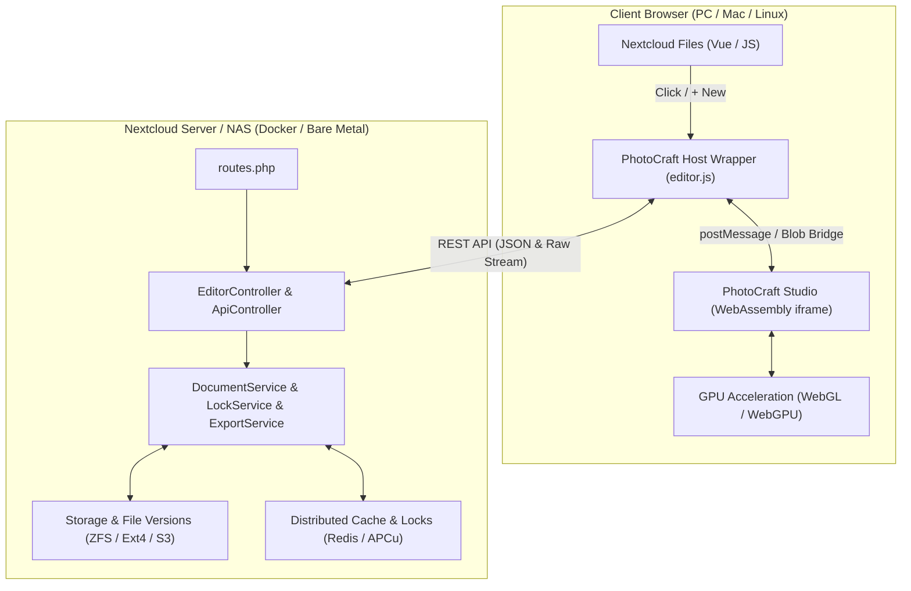

# NextCraft (PhotoCraft Studio for Nextcloud)

[](https://nextcloud.com/)
[](LICENSE)
[](package.json)
[](https://webassembly.org/)
[](test/test_artcraft.js)

**NextCraft** is a professional raster and vector creative studio integrated natively into **Nextcloud Files**, powered by the **PhotoCraft** graphics engine compiled to **WebAssembly (Rust)** with local GPU acceleration.

It delivers a seamless user experience inspired by OnlyOffice: **0% CPU load on the server**, transparent persistence on your Nextcloud storage, automated file versioning, and secure collaboration via exclusive file locking.

---

## 🎨 Key Features

- **100% Client-Side Computation (WebAssembly & GPU)**: All computations, filters, layers, and rendering execute entirely inside the client's browser via WebGL/WebGPU. Your Nextcloud server or NAS consumes 0% CPU for image processing.
- **Comprehensive Format Support**:
  - **`.craft`**: High-performance layered project format.
  - **`.psd`**: Native opening and editing of Adobe Photoshop documents.
  - **Standard graphics**: Direct retouching and editing of `.png`, `.jpg`, `.jpeg`, `.webp`, `.svg`, `.bmp`, `.tiff`, and `.gif`.
- **Deep Integration into Nextcloud Files**:
  - **`+ New`** menu $\rightarrow$ **"PhotoCraft Project"** to create a blank document with a single click.
  - Direct click on any `.craft` or `.psd` file launches the immersive full-screen workspace.
  - Context menu (`...`): **"Open in PhotoCraft"** option available on all image files.
- **Seamless Saving Workflow**:
  - **Direct Save (`Ctrl + S` / `Cmd + S`)**: Silent and unobtrusive saving directly to Nextcloud with a discreet toast notification.
  - **Live Autosave**: Debounced background autosave (3.5s delay) triggered on user interaction.
  - **Automated Versioning**: Every save automatically creates a Nextcloud revision (compatible with ZFS/Btrfs snapshots).
  - **Native Save As (`Ctrl + Shift + S`)**: Integrates official Nextcloud folder picker and prompt dialogs with multi-tab overwrite protection.
- **Collaborative Concurrency & Exclusive Locking**:
  - Automatic exclusive locking refreshed every 15 seconds via lightweight heartbeat.
  - If another user opens the same file, they are automatically placed in **secure read-only mode** with an indication of who is currently editing.
- **Advanced Studio Capabilities**:
  - **Place Embedded Media (`Ctrl + Shift + P`)**: Modal dialog to import local or Nextcloud images as a **new layer** or into a **new dedicated tab**.
  - **Open Document (`Ctrl + O`)**: Browse and open documents directly from Nextcloud storage.
  - **File Properties & Rename (`Ctrl + Alt + Shift + I`)**: Instantly rename projects without leaving the studio.
  - **Public Link Sharing**: Dedicated view and edit access for external users via Nextcloud public share links.

---

## 🏛️ Architecture



---

## 📋 Requirements

- **Nextcloud**: Version 27, 28, 29, 30 or newer (Nextcloud Hub 6 to 9+).
- **PHP**: 8.1, 8.2, or 8.3 with standard extensions required by Nextcloud (`gd`, `mbstring`, `json`).
- **Client Browser**: Any modern web browser supporting WebAssembly and WebGL (Google Chrome, Mozilla Firefox, Apple Safari, Microsoft Edge).

---

## 🚀 Installation Guide

The application installs under the technical identifier **`artcraft`** in your Nextcloud custom applications folder (`custom_apps` or `apps`).

### Method 1: Direct Container Deployment (Docker / Podman - Recommended)

1. **Clone the repository on your host machine or server:**
   ```bash
   git clone https://github.com/nelfazut/nextcraft.git
   cd nextcraft
   ```

2. **Copy the `artcraft` directory into your container's `custom_apps` directory:**
   ```bash
   # If custom_apps is mounted locally:
   cp -r artcraft /path/to/nextcloud/custom_apps/

   # Or directly using docker/podman cp:
   docker cp artcraft/. nextcloud_app:/var/www/html/custom_apps/artcraft/
   ```

3. **Set proper ownership for the web server user:**
   ```bash
   docker exec -u 0 nextcloud_app chown -R www-data:www-data /var/www/html/custom_apps/artcraft
   ```

4. **Enable the application using `occ`:**
   ```bash
   docker exec -u www-data nextcloud_app php occ app:enable artcraft
   ```

5. *(Recommended)* **Refresh Nextcloud asset caches:**
   ```bash
   docker exec -u www-data nextcloud_app php occ maintenance:repair --include-expensive
   ```

---

### Method 2: Automated Deployment via `deploy.sh`

An automated shell script is provided at the repository root:

```bash
# Syntax: ./deploy.sh [TARGET_FOLDER_PATH] [CONTAINER_NAME]
./deploy.sh /mnt/nextcloud/custom_apps/artcraft nextcloud_app
```

The script copies the files, adjusts ownership, and executes `occ app:enable artcraft` automatically.

---

### Method 3: Bare-Metal Server Installation (Debian / Ubuntu / TrueNAS)

1. **Copy the application folder:**
   ```bash
   sudo cp -r artcraft /var/www/nextcloud/apps/
   sudo chown -R www-data:www-data /var/www/nextcloud/apps/artcraft
   ```

2. **Enable the application:**
   ```bash
   sudo -u www-data php /var/www/nextcloud/occ app:enable artcraft
   ```

---

### Method 4: Docker Compose Volume Mount

If you manage Nextcloud using Docker Compose, mount the directory in your `docker-compose.yml`:

```yaml
version: '3.8'

services:
  nextcloud:
    image: nextcloud:latest
    container_name: nextcloud_app
    restart: always
    volumes:
      - nextcloud_data:/var/www/html
      - ./nextcraft/artcraft:/var/www/html/custom_apps/artcraft:ro
    environment:
      - POSTGRES_HOST=db
      - REDIS_HOST=redis
```

After startup, enable the app once:
```bash
docker compose exec -u www-data nextcloud php occ app:enable artcraft
```

---

## ⚡ Reverse-Proxy Caching Optimization (Nginx / Apache / Caddy)

The WebAssembly studio runtime uses a precompiled static binary (`photocraft-web-*.wasm`, ~24 MB). To achieve instant sub-second startup through browser caching, configure your reverse-proxy to serve `.wasm` assets with immutable cache headers.

### Nginx Configuration
Add this location block within your Nextcloud server block:

```nginx
# High-performance caching for PhotoCraft WebAssembly engine
location ~* \.wasm$ {
    types { application/wasm wasm; }
    add_header Cache-Control "public, max-age=31536000, immutable";
    add_header X-Content-Type-Options "nosniff";
    access_log off;
}
```

### Caddy Configuration
```caddy
@wasm path *.wasm
header @wasm Cache-Control "public, max-age=31536000, immutable"
```

---

## ⌨️ Studio Keyboard Shortcuts

| Shortcut | Action |
|---|---|
| `Ctrl + S` / `Cmd + S` | **Save** directly to Nextcloud (silent toast notification) |
| `Ctrl + Shift + S` | **Save As** in Nextcloud (folder picker + file name prompt) |
| `Ctrl + O` | **Open Document** (from Nextcloud storage or local device) |
| `Ctrl + Shift + P` | **Place Media** (embed as layer or open as new tab) |
| `Ctrl + Alt + Shift + I` | **File Properties & Rename** live |
| `Ctrl + Q` | **Exit** studio and return to Nextcloud Files |
| `Ctrl + A` / `Ctrl + C` / `Ctrl + V` | Select all / Copy / Paste layers |
| `Ctrl + Z` / `Ctrl + Y` | Undo / Redo |

---

## 📁 Repository Structure

```text
nextcraft/
├── artcraft/                     # Nextcloud Application (ID: artcraft)
│   ├── appinfo/
│   │   ├── info.xml              # Application metadata & mimetype associations
│   │   └── routes.php            # HTTP REST API routing definitions
│   ├── lib/
│   │   ├── AppInfo/
│   │   │   └── Application.php   # Nextcloud framework bootstrap & event listeners
│   │   ├── Controller/
│   │   │   ├── EditorController.php     # Full-screen studio rendering & CSP headers
│   │   │   ├── ApiController.php        # Lightweight REST controller (delegates to services)
│   │   │   └── PublicPageController.php # Public share link viewer & editor
│   │   ├── Service/
│   │   │   ├── DocumentService.php      # CRUD file lifecycle, payload validation & .craft format
│   │   │   ├── ExportService.php        # Image export engine (PNG, JPG, SVG)
│   │   │   ├── LockService.php          # Exclusive collaborative locking (TTL & heartbeat)
│   │   │   └── DirectEditor.php         # Nextcloud DirectEditing API implementation
│   │   └── Listeners/
│   │       ├── RegisterTemplateFileCreatorListener.php # "+ New -> PhotoCraft Project" option
│   │       ├── CreateFromTemplateListener.php          # Automatic template initialization
│   │       └── DirectEditorListener.php                # Association with supported mimetypes
│   ├── templates/
│   │   ├── editor.php            # Primary workspace & GPU splash screen
│   │   ├── public.php            # Public share viewer template
│   │   └── error.php             # User-friendly error page
│   ├── css/
│   │   └── editor.css            # Full-screen OnlyOffice-style and dark theme styles
│   ├── js/
│   │   ├── main.js               # Files integration (+, direct click, context menu)
│   │   ├── editor.js             # Main client orchestrator
│   │   └── editor/               # Specialized client modules
│   │       ├── ui.js             # Splash screen management & toast notifications
│   │       ├── state.js          # Tracked documents registry & .craft normalization
│   │       ├── autosave.js       # Collaborative lock heartbeat & debounced autosave (3.5s)
│   │       ├── modals.js         # Dialog modals (Asset picker, Open, Save As)
│   │       └── bridge.js         # Host <-> Wasm iframe communication
│   ├── web/                      # Autonomous PhotoCraft WebAssembly studio
│   │   ├── index.html            # Clean HTML shell loading Wasm runtime
│   │   ├── bridge.js             # Save state machine & synthetic drag-and-drop
│   │   ├── photocraft-web-*.js   # WebAssembly JS bindings
│   │   └── photocraft-web-*.wasm # Static WebAssembly binary (WebGL/WebGPU)
│   └── img/
│       ├── app.svg               # Application icon
│       ├── photocraft.svg        # Official PhotoCraft logo
│       └── mime-craft.svg        # Official .craft document icon
├── engine/                       # Vector engine in Rust (optional/Wasm compilation)
│   ├── Cargo.toml                # Dependencies: wasm-bindgen, web-sys, serde
│   ├── src/                      # Rust sources (lib.rs, model.rs, renderer.rs, export.rs)
│   └── build.sh                  # wasm-pack build script
├── test/
│   └── test_artcraft.js          # Automated integrity and regression test suite
├── deploy.sh                     # Automated shell deployment script
├── Makefile                      # Make targets (test, package, deploy)
├── package.json                  # Node.js dependencies and test scripts
├── LICENSE                       # GNU AGPLv3 official license
└── README.md                     # Project documentation
```

---

## 🧪 Tests & Quality Assurance

NextCraft includes automated unit, architecture, and end-to-end integration tests:

```bash
# Run integrity and architectural tests:
npm test
# or via Makefile:
make test
```

### End-to-End Integration Suite (Playwright)
A full 12-scenario Playwright E2E suite validates real-world execution inside a live Nextcloud container:
1. User login and session authentication.
2. `+ New` menu verification (*PhotoCraft Project .craft*).
3. Opening existing `.craft` and `.psd` projects.
4. Silent direct saving (`Ctrl + S`).
5. Live debounced autosave during editing.
6. Native Nextcloud *Save As* dialogs (folder picker + prompt).
7. Exclusive collaborative file locking (*LockService*).
8. Contextual *"Open in PhotoCraft"* action on image files.

---

## 📄 License

This project is licensed under the **GNU Affero General Public License v3.0 (AGPLv3)**.  
See the [`LICENSE`](LICENSE) file for complete terms.

---

## 👥 Credits & Acknowledgements

- **ArtCraft Team**: Nextcloud integration, layered architecture, WebAssembly bridge, persistence and collaborative locking services.
- **PhotoCraft Core**: Pure-Rust graphics engine and WebAssembly studio workspace.
- **Nextcloud Community**: DirectEditing API, EventDispatcher, and template file creation system.
