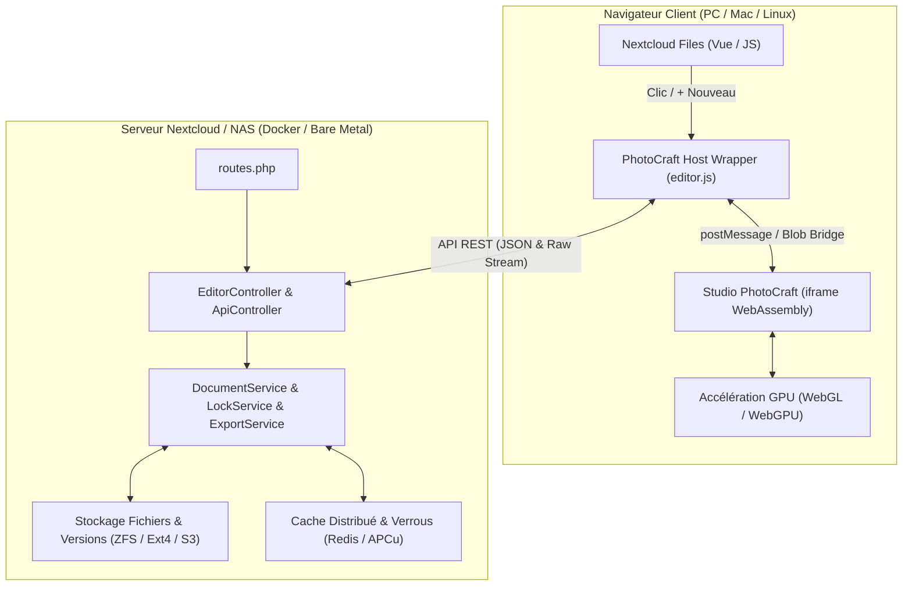

# NextCraft (PhotoCraft Studio pour Nextcloud)

[](https://nextcloud.com/)
[](LICENSE)
[](package.json)
[](https://webassembly.org/)
[](test/test_artcraft.js)

**NextCraft** est une application d'édition graphique matricielle et vectorielle professionnelle intégrée directement dans **Nextcloud Files**, propulsée par le moteur créatif **PhotoCraft** en **WebAssembly (Rust)** et accéléré par GPU.

Elle offre une expérience utilisateur fluide et complète, inspirée de l'intégration d'OnlyOffice : **0 % de charge CPU sur le serveur**, persistance transparente sur votre stockage Nextcloud, versioning automatique et collaboration sécurisée par verrouillage exclusif.

---

## 🎨 Points Forts & Fonctionnalités

- **100 % Côté Client (WebAssembly & GPU)** : Les calculs, filtres, calques et rendus s'exécutent entièrement dans le navigateur de l'utilisateur via WebGL/WebGPU. Votre serveur Nextcloud ou NAS ne consomme aucun cycle processeur pour le traitement d'images.
- **Support des Formats** :
  - **`.craft`** : Format natif de composition par calques haute performance.
  - **`.psd`** : Ouverture et édition transparente des fichiers Adobe Photoshop.
  - **Images standards** : Édition et retouche directe de `.png`, `.jpg`, `.jpeg`, `.webp`, `.svg`, `.bmp`, `.tiff`, `.gif`.
- **Intégration Profonde dans Nextcloud Files** :
  - Menu **`+ Nouveau`** $\rightarrow$ **« Projet PhotoCraft »** pour créer un nouveau document en un clic.
  - Clic direct sur n'importe quel fichier `.craft` ou `.psd` pour ouvrir l'espace de travail immersif en plein écran.
  - Menu contextuel (`...`) : option **« Ouvrir dans PhotoCraft »** disponible sur toutes les images.
- **Workflow de Sauvegarde Transparent** :
  - **Sauvegarde Directe (`Ctrl + S`)** : Enregistrement silencieux et discret directement sur Nextcloud avec notification toast.
  - **Sauvegarde Automatique (*Live Autosave*)** : Déclenchement automatique détemporisé (debounce de 3,5 s) à chaque interaction utilisateur.
  - **Versioning automatique** : Chaque sauvegarde s'appuie sur le système de versions natif de Nextcloud (compatible snapshots ZFS/Btrfs).
  - **Enregistrer sous natif (`Ctrl + Shift + S`)** : Ouvre les sélecteurs natifs Nextcloud (choix du dossier de destination + saisie du nom) avec protection anti-écrasement multi-onglets.
- **Collaboration & Verrouillage Exclusif (*File Locking*)** :
  - Verrouillage exclusif automatique avec renouvellement par pulsation (*heartbeat*) toutes les 15 secondes.
  - Si un second utilisateur ouvre le même fichier, il est automatiquement basculé en **mode lecture seule sécurisé** avec indication de l'utilisateur éditeur.
- **Fonctionnalités Studio Avancées** :
  - **Importer une image (`Ctrl + Shift + P`)** : Boîte modale permettant d'importer une image locale ou depuis Nextcloud, soit en tant que **nouveau calque**, soit dans un **nouvel onglet**.
  - **Ouvrir un document (`Ctrl + O`)** : Exploration et ouverture directe depuis le stockage Nextcloud.
  - **Renommer (`Ctrl + Alt + Shift + I`)** : Renommage immédiat du fichier sans quitter le studio.
  - **Partages Publics** : Consultation et édition autorisée pour les partages par lien public sans compte Nextcloud.

---

## 🏛️ Architecture



---

## 📋 Prérequis

- **Nextcloud** : Version 27, 28, 29, 30 ou ultérieure (Nextcloud Hub 6 à 9+).
- **PHP** : 8.1, 8.2 ou 8.3 avec les extensions requises par Nextcloud (`gd`, `mbstring`, `json`).
- **Navigateur Client** : N'importe quel navigateur moderne supportant WebAssembly et WebGL (Google Chrome, Mozilla Firefox, Apple Safari, Microsoft Edge).

---

## 🚀 Guide d'Installation

L'application s'installe sous l'identifiant technique **`artcraft`** dans le dossier des applications personnalisées de Nextcloud (`custom_apps` ou `apps`).

### Méthode 1 : Déploiement direct avec Docker / Conteneur (Recommandé)

1. **Clonez le dépôt sur votre machine hôte ou serveur :**
   ```bash
   git clone https://github.com/nelfazut/nextcraft.git
   cd nextcraft
   ```

2. **Copiez le dossier `artcraft` dans le dossier `custom_apps` monté de votre conteneur :**
   ```bash
   # Exemple avec montage local :
   cp -r artcraft /chemin/vers/nextcloud/custom_apps/

   # Ou directement via podman / docker cp :
   docker cp artcraft/. nextcloud_app:/var/www/html/custom_apps/artcraft/
   ```

3. **Ajustez les permissions pour le serveur web :**
   ```bash
   docker exec -u 0 nextcloud_app chown -R www-data:www-data /var/www/html/custom_apps/artcraft
   ```

4. **Activez l'application via `occ` :**
   ```bash
   docker exec -u www-data nextcloud_app php occ app:enable artcraft
   ```

5. *(Recommandé)* **Mettez à jour les caches de Nextcloud :**
   ```bash
   docker exec -u www-data nextcloud_app php occ maintenance:repair --include-expensive
   ```

---

### Méthode 2 : Déploiement automatique via `deploy.sh`

Un script d'automatisation est inclus à la racine du projet :

```bash
# Syntaxe : ./deploy.sh [CHEMIN_DOSSIER_CIBLE] [NOM_DU_CONTENEUR]
./deploy.sh /mnt/nextcloud/custom_apps/artcraft nextcloud_app
```

Le script se charge de copier les fichiers, d'attribuer les permissions et d'exécuter `occ app:enable artcraft` automatiquement.

---

### Méthode 3 : Installation sur serveur Bare-Metal (Debian / Ubuntu / TrueNAS)

1. **Copiez le dossier de l'application :**
   ```bash
   sudo cp -r artcraft /var/www/nextcloud/apps/
   sudo chown -R www-data:www-data /var/www/nextcloud/apps/artcraft
   ```

2. **Activez l'application en ligne de commande :**
   ```bash
   sudo -u www-data php /var/www/nextcloud/occ app:enable artcraft
   ```

---

### Méthode 4 : Docker Compose avec volume monté

Si vous gérez Nextcloud avec Docker Compose, vous pouvez mapper directement l'application dans votre fichier `docker-compose.yml` :

```yaml
version: '3.8'

services:
  nextcloud:
    image: nextcloud:latest
    container_name: nextcloud_app
    restart: always
    volumes:
      - nextcloud_data:/var/www/html
      - ./nextcraft/artcraft:/var/www/html/custom_apps/artcraft:ro
    environment:
      - POSTGRES_HOST=db
      - REDIS_HOST=redis
```

Après le démarrage, activez simplement l'application une fois :
```bash
docker compose exec -u www-data nextcloud php occ app:enable artcraft
```

---

## ⚡ Optimisation du Reverse-Proxy (Nginx / Apache / Caddy)

Le studio WebAssembly utilise un fichier statique pré-compilé (`photocraft-web-*.wasm`, ~24 Mo). Pour une vitesse de chargement instantanée (mise en cache locale dans le navigateur), configurez votre reverse-proxy pour servir le binaire avec un cache immutable.

### Configuration Nginx
Ajoutez ce bloc dans la configuration de votre serveur virtuel Nextcloud :

```nginx
# Cache haute performance pour le moteur WebAssembly PhotoCraft
location ~* \.wasm$ {
    types { application/wasm wasm; }
    add_header Cache-Control "public, max-age=31536000, immutable";
    add_header X-Content-Type-Options "nosniff";
    access_log off;
}
```

### Configuration Caddy
```caddy
@wasm path *.wasm
header @wasm Cache-Control "public, max-age=31536000, immutable"
```

---

## ⌨️ Raccourcis Clavier du Studio

| Raccourci | Action |
|---|---|
| `Ctrl + S` / `Cmd + S` | **Enregistrer** directement dans Nextcloud (silencieux) |
| `Ctrl + Shift + S` | **Enregistrer sous** dans Nextcloud (sélecteur de dossier + nom) |
| `Ctrl + O` | **Ouvrir un document** (depuis Nextcloud ou local) |
| `Ctrl + Shift + P` | **Insérer un média** (Place Embedded comme calque ou nouvel onglet) |
| `Ctrl + Alt + Shift + I` | **Propriétés & Renommer** le document en direct |
| `Ctrl + Q` | **Quitter** et retourner à l'explorateur de fichiers Nextcloud |
| `Ctrl + A` / `Ctrl + C` / `Ctrl + V` | Sélectionner tout / Copier / Coller des calques |
| `Ctrl + Z` / `Ctrl + Y` | Annuler / Rétablir |

---

## 📁 Structure du Dépôt

```text
nextcraft/
├── artcraft/                     # Application Nextcloud (ID: artcraft)
│   ├── appinfo/
│   │   ├── info.xml              # Déclaration officielle de l'application & mimetypes
│   │   └── routes.php            # Définition des routes HTTP de l'API REST
│   ├── lib/
│   │   ├── AppInfo/
│   │   │   └── Application.php   # Bootstrap & enregistrement des événements Nextcloud
│   │   ├── Controller/
│   │   │   ├── EditorController.php     # Rendu du studio plein écran & configuration CSP
│   │   │   ├── ApiController.php        # Contrôleur REST allégé (délégation aux services)
│   │   │   └── PublicPageController.php # Gestion des partages par lien public
│   │   ├── Service/
│   │   │   ├── DocumentService.php      # Gestion CRUD, validation & format .craft
│   │   │   ├── ExportService.php        # Moteur d'exportation PNG, JPG, SVG
│   │   │   ├── LockService.php          # Verrouillage collaboratif exclusif (TTL & Heartbeat)
│   │   │   └── DirectEditor.php         # Implémentation DirectEditing de Nextcloud
│   │   └── Listeners/
│   │       ├── RegisterTemplateFileCreatorListener.php # Ajout de "+ Nouveau -> Projet PhotoCraft"
│   │       ├── CreateFromTemplateListener.php          # Initialisation automatique du template
│   │       └── DirectEditorListener.php                # Association aux extensions supportées
│   ├── templates/
│   │   ├── editor.php            # Page de travail principale & Splash Screen GPU
│   │   ├── public.php            # Vue pour les partages publics sans authentification
│   │   └── error.php             # Page d'erreur conviviale
│   ├── css/
│   │   └── editor.css            # Styles plein écran OnlyOffice-like et dark mode
│   ├── js/
│   │   ├── main.js               # Intégration Files (+, clic direct, menu contextuel)
│   │   ├── editor.js             # Orchestrateur client principal
│   │   └── editor/               # Modules client spécialisés
│   │       ├── ui.js             # Gestion du splash screen & notifications toasts
│   │       ├── state.js          # Registre des documents suivis & format .craft
│   │       ├── autosave.js       # Heartbeat de verrou et autosave détemporisé (3.5s)
│   │       ├── modals.js         # Boîtes de dialogue (Asset picker, Open, Save As)
│   │       └── bridge.js         # Échanges hôte <-> iframe Wasm
│   ├── web/                      # Studio PhotoCraft WebAssembly autonome
│   │   ├── index.html            # Conteneur Wasm épuré
│   │   ├── bridge.js             # Machine à états de sauvegarde & injection Drop
│   │   ├── photocraft-web-*.js   # Bindings JS WebAssembly
│   │   └── photocraft-web-*.wasm # Moteur WebAssembly binaire statique
│   └── img/
│       ├── app.svg               # Icône de l'application
│       ├── photocraft.svg        # Logo officiel PhotoCraft
│       └── mime-craft.svg        # Icône de document .craft
├── engine/                       # Moteur vectoriel en Rust (optionnel/compilation Wasm)
│   ├── Cargo.toml                # Dépendances wasm-bindgen, web-sys, serde
│   ├── src/                      # Sources Rust (lib.rs, model.rs, renderer.rs, export.rs)
│   └── build.sh                  # Script de compilation wasm-pack
├── test/
│   └── test_artcraft.js          # Suite de tests d'intégrité et de non-régression
├── deploy.sh                     # Script shell de déploiement automatique
├── Makefile                      # Automatisation (test, package, deploy)
├── package.json                  # Dépendances et scripts de test
├── LICENSE                       # Licence officielle GNU AGPLv3
└── README.md                     # Documentation officielle du projet
```

---

## 🧪 Tests & Qualité de Code

Le projet intègre une suite de tests automatisés validant l'intégrité des métadonnées, des routes, des binaires et de l'architecture :

```bash
# Exécuter les tests unitaires et structurels :
npm test
# ou via le Makefile :
make test
```

### Tests d'Intégration Bout-en-Bout (Playwright)
Une suite de tests E2E complète vérifie l'interaction dans un conteneur Nextcloud réel :
1. Connexion et authentification utilisateur.
2. Présence de l'option *Projet PhotoCraft (`.craft`)* dans le menu `+ Nouveau`.
3. Ouverture d'un projet `.craft` ou `.psd` existant.
4. Sauvegarde directe (`Ctrl + S`) sans perturbation visuelle.
5. Autosave détemporisé en cours d'édition.
6. Enregistrement sous natif via le sélecteur de dossier et prompt Nextcloud.
7. Verrouillage collaboratif exclusif (*LockService*).
8. Action contextuelle *« Ouvrir dans PhotoCraft »* sur les images.

---

## 📄 Licence

Ce projet est distribué sous la licence libre **GNU Affero General Public License v3.0 (AGPLv3)**.  
Consultez le fichier [`LICENSE`](LICENSE) pour plus de détails.

---

## 👥 Crédits & Remerciements

- **ArtCraft Team** : Intégration Nextcloud, architecture en couches, pont WebAssembly, services de persistance et de verrouillage collaboratif.
- **PhotoCraft Core** : Moteur graphique pur Rust et studio créatif WebAssembly.
- **Nextcloud Community** : API DirectEditing, EventDispatcher et système de modèles de fichiers.
